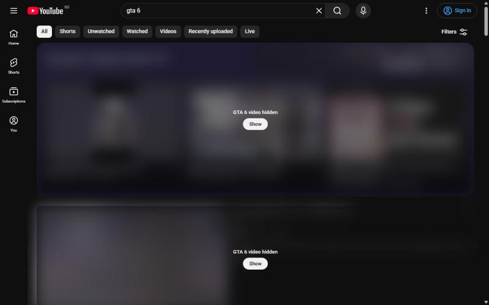
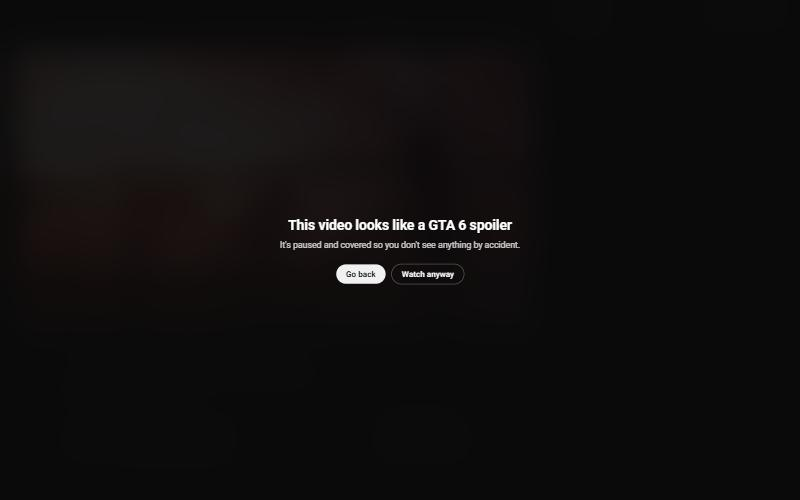
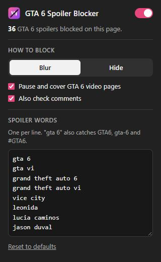

# GTA 6 Spoiler Blocker for YouTube

A small Chrome extension (Manifest V3) that keeps **GTA 6 spoilers** off YouTube until you're ready.
GTA 6 videos, Shorts, comments and even autoplay previews get blurred or hidden, and opening a GTA 6 video
stops it at 0:00 behind a cover.

| Blurred search results | Spoiler video stopped | Settings |
|---|---|---|
|  |  |  |

## Features

- **Blur or hide** GTA 6 videos, Shorts, playlists, posts and the "Grand Theft Auto VI" game card on the home page,
  search, the sidebar next to a video, channel pages and notifications. Blurred items get a **Show** button.
- **Comments** that mention GTA 6 are blurred too (optional).
- **Autoplay and hover previews** over a blocked video are paused and hidden, so no footage slips through.
- **Opening a GTA 6 video** (from a link, autoplay or the sidebar) holds it at 0:00 and covers the page, with
  **Go back** and **Watch anyway**. Other videos play normally after a quick title check.
- **Your own spoiler words.** Spaces match any separator, so `gta 6` also catches `GTA6`, `gta-6` and `#GTA6`.
  Words only match whole, so `gta 6` doesn't match "gta 60fps".
- A live **count** of what was blocked on the current page.
- No accounts, no tracking, no network requests. The only permission is `storage`.

## Install

### From a release (easiest)

1. Download `gta6-spoiler-blocker-v1.0.0.zip` from the [Releases](../../releases) page and unzip it.
2. Open `chrome://extensions` in Chrome.
3. Turn on **Developer mode** (top right).
4. Click **Load unpacked** and pick the unzipped folder (the one with `manifest.json` in it).
5. Pin the extension from the puzzle-piece menu, then reload any YouTube tabs that were already open.

### From source

Clone or download this repository, then do steps 2–5 above with the repository folder itself.

Works in Chrome, Edge, Brave and other Chromium browsers.

## Settings

Click the toolbar icon:

| Setting | What it does |
|---|---|
| On/off switch | Turns all blocking on or off |
| Blur / Hide | Blur with a **Show** button, or remove blocked items from the page |
| Pause and cover GTA 6 video pages | The full-page cover on GTA 6 videos |
| Also check comments | Blur comments that mention GTA 6 |
| Spoiler words | One per line; changes apply right away |

Default spoiler words: `gta 6`, `gta vi`, `grand theft auto 6`, `grand theft auto vi`, `vice city`, `leonida`,
`lucia caminos`, `jason duval`. `vice city` also blocks videos about the old *GTA Vice City*; delete that line if
you want those back. Settings sync across your signed-in Chrome browsers.

## How it works

The content script reads the text YouTube already shows (titles, channel names, comment text and image labels)
and checks it against your spoiler words. It watches the page for changes, since YouTube loads results as you scroll
and reuses tiles for new videos. On a video page it holds playback until the title has been checked, using
the player's title bar as an early hint so a spoiler is covered before YouTube finishes drawing the page.

## Known limitations

- It only knows what a video says about itself. A GTA 6 clip with no GTA 6 words in its title, channel name or
  description text on the page won't be caught. Add channel names or other words to your list to widen it.
- Thumbnails are judged by their text, not by what the picture shows.
- YouTube changes its page structure from time to time; if something stops being blocked, please open an issue.
- Tested on desktop YouTube. The mobile site (`m.youtube.com`) and the Shorts feed have less coverage.

## Building a release zip

```powershell
powershell -ExecutionPolicy Bypass -File scripts\package.ps1
```

This writes `dist\gta6-spoiler-blocker-v<version>.zip` with only the files the extension needs.

## Project files

| File | What it does |
|---|---|
| `manifest.json` | Extension setup (Manifest V3) |
| `shared.js` | Default settings and the spoiler-word matcher |
| `content.js`, `content.css` | Runs on YouTube: blurs/hides spoilers, blocks previews, covers spoiler videos |
| `popup.html`, `popup.css`, `popup.js` | The toolbar settings panel |
| `icons/` | Extension icons |
| `scripts/package.ps1` | Builds the release zip |

## Privacy

Nothing leaves your browser. See [PRIVACY.md](PRIVACY.md).

## License

[MIT](LICENSE). Not affiliated with Rockstar Games, Take-Two Interactive or YouTube. "Grand Theft Auto" is a
trademark of Take-Two Interactive.
